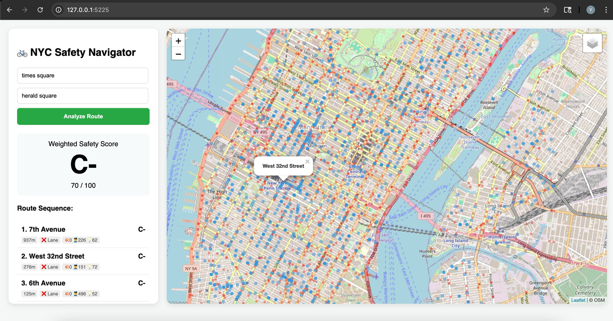
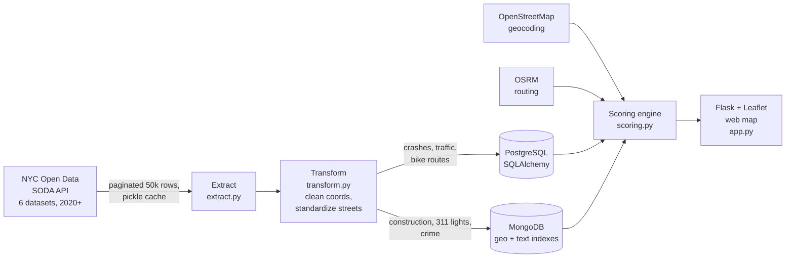

# NYC Bike Safety Navigator

**Enter two NYC addresses and get a bike route graded A+ to F, street by street.** An end-to-end data engineering project that pulls about 5 million records from 6 NYC Open Data sources and loads them into a hybrid **PostgreSQL + MongoDB** backend. A weighted safety model scores every street on the route, and the results are served in a **Flask + Leaflet** web map.

Final project for Columbia University APAN 5400 (Fall 2025, Group 9). **Received a perfect score on the final technical architecture demo.**



## Why

NYC has one of the largest cycling populations in the US, and thousands of cyclist crashes every year. Navigation apps show the *fastest* route, not the *safest* one. This tool tells a cyclist how risky each street on their route is, and shows city planners where the risk concentrates.

## Architecture



**Why two databases?** Crashes, traffic counts and bike routes are clean tables that benefit from SQL joins and aggregates, so they go in PostgreSQL. Construction permits, 311 complaints and crime reports have inconsistent fields and are queried by location, so they go in MongoDB. MongoDB stores them as flexible documents with latitude/longitude and street-name indexes.

## Data sources

All data is public and non-sensitive, from [NYC Open Data](https://opendata.cityofnewyork.us/), filtered to 2020 onward.

| Dataset | Rows pulled (target) | Stored in | Used for |
| --- | --- | --- | --- |
| [Motor Vehicle Collisions: Crashes](https://data.cityofnewyork.us/d/h9gi-nx95) | 900K | PostgreSQL | Crashes, cyclist injuries and fatalities per street |
| [Automated Traffic Volume Counts](https://data.cityofnewyork.us/d/7ym2-wayt) | 400K | PostgreSQL | Traffic exposure |
| [NYC Bike Routes](https://data.cityofnewyork.us/d/mzxg-pwib) | 40K (full) | PostgreSQL | Bike lane presence |
| [Street Construction Permits](https://data.cityofnewyork.us/d/tqtj-sjs8) | 1.3M | MongoDB | Active construction |
| [311 Street Light & Traffic Signal Complaints](https://data.cityofnewyork.us/d/erm2-nwe9) | 1.2M | MongoDB | Poor lighting |
| [NYPD Complaint Data](https://data.cityofnewyork.us/d/qgea-i56i) | 1.3M | MongoDB | Nearby crime |

## How the safety score works

Each street on the route starts at **100** and loses points for hazards, with a floor of **20**.

| Factor | Points per event | Cap | Source |
| --- | --- | --- | --- |
| Crashes, per km of street | 2 | 40 | PostgreSQL |
| Cyclist injuries | 10 | none | PostgreSQL |
| Cyclist fatalities | 30 | none | PostgreSQL |
| Poor lighting complaints within ~200 m | 3 | 10 | MongoDB |
| Crime reports within ~200 m | 2 | 20 | MongoDB |
| Construction permits (by location or street name) | 3 | 10 | MongoDB |

Three adjustments are applied:
- **Crashes are normalized by street length**, so a 2-mile avenue isn't punished more than a 200 m block just for being longer.
- **Busy streets (more than 20K vehicles/day) get the penalty × 0.6**, because more crashes there partly reflect more exposure.
- **Streets with a bike lane get the penalty × 0.7**, which rewards protective infrastructure.

The route grade is a **distance-weighted average** of the street scores, so a long stretch counts more than a short one. The grades run A+ (98+), A (93+), A- (90+), B+ (87+) and so on down to D (60+) and F.

**Example:** on 7th Avenue, a 937 m stretch with 2 crashes, 1 injury, 1 lighting complaint, 1 crime report and 1 construction permit loses about 22 points. The high-traffic adjustment brings that to about 13, for a score of **86 (B)**.

## Engineering highlights

- **Paginated API extraction** in 50K-row pages with throttling and a local pickle cache, so the multi-GB pull runs once.
- **Street-name standardization** turns "West 43rd Street" into "WEST 43RD ST", so crashes, traffic, bike lanes and construction match across datasets that use different conventions.
- **Hybrid geospatial querying:** a ~200 m bounding-box search in MongoDB for lights and crime, plus a geo-or-text fallback for construction permits that lack coordinates.
- **Responsive map:** each map layer gets a random sample of up to 3,000 points near the route, so it stays fast even with millions of records.
- **Parameterized SQL** everywhere, plus credentials read from environment variables, not hard-coded.
- **Automated tests** cover the transform, load, scoring and Flask steps end to end, using SQLite and an in-memory MongoDB (`pytest tests/`).

## Repository structure

```
├── src/
│   ├── config.py        # data sources, scoring weights, DB settings
│   ├── extract.py       # Phase 1: NYC Open Data API -> cache
│   ├── transform.py     # Phase 2: clean coordinates, standardize street names
│   ├── load.py          # Phase 3: PostgreSQL + MongoDB loading and indexes
│   ├── pipeline.py      # runs extract -> transform -> load
│   ├── scoring.py       # Phase 4: geocoding, routing, street + route scoring
│   ├── app.py           # Phase 5: Flask web app
│   └── templates/index.html   # Leaflet map UI
├── notebooks/NYC_Bike_Safety_Navigator.ipynb   # original end-to-end notebook
├── tests/test_pipeline.py
├── docs/app_screenshot.png
├── requirements.txt
└── .env.example
```

## How to run

**Requires** Python 3.10+, a local PostgreSQL server and a local MongoDB server.

```bash
pip install -r requirements.txt
createdb bike_safety_db                      # PostgreSQL database
export DATABASE_URL=postgresql://postgres:<password>@localhost:5432/bike_safety_db
export MONGO_URL=mongodb://localhost:27017/

python src/pipeline.py    # download (first run takes a while), clean and load
python src/app.py         # open http://127.0.0.1:5333
pytest tests/             # run the test suite (no databases needed)
```

## Cost estimate for deployment

Estimated at **~$67/month** for year 1: a MongoDB Atlas M10 cluster on AWS ($66.82/month) plus the `bikesafe.nyc` domain, for about 7.7 GB of data.

## What's next

- Real-time NYC traffic and 511 feeds for live scores
- Time-of-day and seasonal risk patterns
- A predictive model to flag streets whose risk is rising before crashes increase
- Integration with Citi Bike route planning

## Team and my role

Group 9: Aldrich Yap, Anh Pham, Darren Lin, Jiarong Ying, Yvonne Lin.

I worked across every phase of the project: data cleaning and street-name standardization, loading PostgreSQL and MongoDB, the safety-scoring algorithm, the Flask web app, and the final presentation.

**Tech stack:** Python, pandas, SQLAlchemy, PostgreSQL, MongoDB (PyMongo), Flask, Jinja2, Leaflet.js, OpenStreetMap Nominatim, OSRM, REST APIs, pytest
